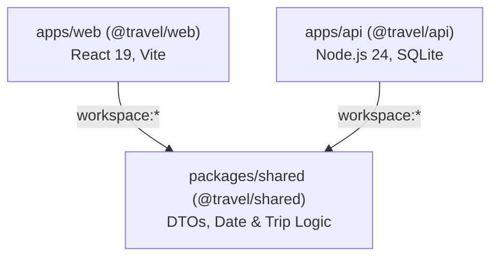

# SDD: pnpm Workspace Monorepo Refactoring Specification

- **專案名稱**：途間｜旅程規劃 (travel-site)
- **架構模式**：pnpm workspace Monorepo
- **目標**：明確劃分前端 (`apps/web`) 與後端 (`apps/api`)，抽出共用領域層 (`packages/shared`)，並無縫銜接 Docker、CI/CD 與開發體驗。

---

## 1. 目錄架構規劃 (Target Architecture)

```text
travel-site/
├── pnpm-workspace.yaml          # 工作區定義 (apps/*, packages/*)
├── package.json                 # 根工作區管理 (全局指令封裝)
├── pnpm-lock.yaml               # 統一鎖定檔
├── tsconfig.json                # 根 TypeScript 基礎配置
├── apps/
│   ├── web/                     # @travel/web (React 19 + Vite 前端應用)
│   │   ├── package.json
│   │   ├── index.html
│   │   ├── vite.config.ts       # 前端打包配置，開發模式反向代理 /api 至 4187
│   │   ├── tsconfig.json
│   │   └── src/
│   │       ├── main.tsx
│   │       ├── App.tsx
│   │       ├── index.css
│   │       ├── components/      # UI 元件
│   │       └── services/        # 前端專屬服務 (auth.service, map.service, walking.service)
│   │
│   └── api/                     # @travel/api (Node.js 24 原生極簡後端)
│       ├── package.json
│       └── src/
│           ├── server.mjs       # 生產 HTTP 入口 (靜態託管 + API 轉發)
│           ├── routes.mjs       # Trip & Walk API 核心路由
│           ├── oidc.mjs         # Synology SSO 身分驗證
│           └── ai/              # AI 業務邏輯模組
│               ├── assistant.mjs
│               ├── providers.mjs
│               ├── skills.mjs
│               └── crypto.mjs
│
├── packages/
│   └── shared/                  # @travel/shared (領域模型與驗證邏輯)
│       ├── package.json
│       ├── tsconfig.json
│       └── src/
│           ├── index.ts         # 統一匯出
│           ├── dto/             # trip-workspace.dto.ts
│           └── services/        # trip.service.ts, date.service.ts
│
├── tests/                       # 全域單元與整合測試
├── docker/                      # Dockerfile 與 compose 配置 (支援 pnpm)
├── .agents/skills/              # Agent Skills 規範檔
└── .specs/                      # SDD 規範與計畫
```

---

## 2. 套件邊界與相依關係 (Package Boundaries & Dependencies)



1. **`@travel/shared`**：
   - 僅包含純 TypeScript / JavaScript 領域計算與資料驗證，零外部 npm 依賴。
   - 匯出 `trip-workspace.dto.ts`、`trip.service.ts`、`date.service.ts`。
2. **`@travel/api`**：
   - 引入 `@travel/shared`。
   - 採用 Node.js 原生能力（`node:sqlite`、`node:http`、`fetch`），維持 0 runtime npm dependencies。
3. **`@travel/web`**：
   - 引入 `@travel/shared`。
   - 負責渲染 React SPA，開發模式下透過 Vite Proxy 轉發 `/api` 至 `@travel/api`。

---

## 3. 開發與建置流程 (Developer Experience & Build Pipeline)

1. **本機開發 (`pnpm dev`)**：
   - 同步啟動 `@travel/api`（Port 4187）與 `@travel/web`（Port 5173）。
   - 前端訪問 `http://localhost:5173`，所有 `/api/*` 自動反向代理至 `http://127.0.0.1:4187`。
2. **測試 (`pnpm test`)**：
   - 執行現有 83 項測試，路徑自動對應至 `@travel/api` 與 `@travel/shared`。
3. **型別與 Lint 檢查 (`pnpm lint` / `pnpm check`)**：
   - Oxlint 與 TypeScript 全工作區檢查。

---

## 4. Docker 與 CI/CD 最佳化策略 (Docker & Deployment)

- **pnpm 快取層最佳化**：
  - 在 Docker build 中啟用 BuildKit cache mount (`--mount=type=cache,target=/root/.local/share/pnpm/store`)。
  - 使用 `pnpm install --frozen-lockfile` 快速安裝。
- **生產映像最小化**：
  - 利用 `pnpm --filter @travel/api deploy --prod /prod/api` 抽出運行目錄。
  - 將前端編譯之 `apps/web/dist` 置入後端託管路徑。
  - Runtime 維持使用極輕量 `node:24-alpine`。

---

## 5. 執行步驟檢核表 (Execution Checklist)

- [x] 步驟 1：建立 `pnpm-workspace.yaml` 與根 `package.json`。
- [x] 步驟 2：建立 `packages/shared` 並遷移共用 DTO 與 Services。
- [x] 步驟 3：建立 `apps/api` 並遷移後端伺服器、路由與 AI 模組。
- [x] 步驟 4：建立 `apps/web` 並遷移前端 React、Vite、HTML 與 UI 元件。
- [x] 步驟 5：執行 `pnpm install` 並建立 `pnpm-lock.yaml`。
- [x] 步驟 6：更新 `tests/` 中的模組引入路徑，確保 83 項測試全部通過。
- [x] 步驟 7：更新 `docker/Dockerfile`、`docker-compose.*.yml` 與 `.github/workflows/publish-image.yml`。
- [x] 步驟 8：驗證 `pnpm dev`、`pnpm build`、`pnpm test` 與 Docker 生產建置。
- [x] 步驟 9：依 Commit Convention 規範提交代碼變更。
